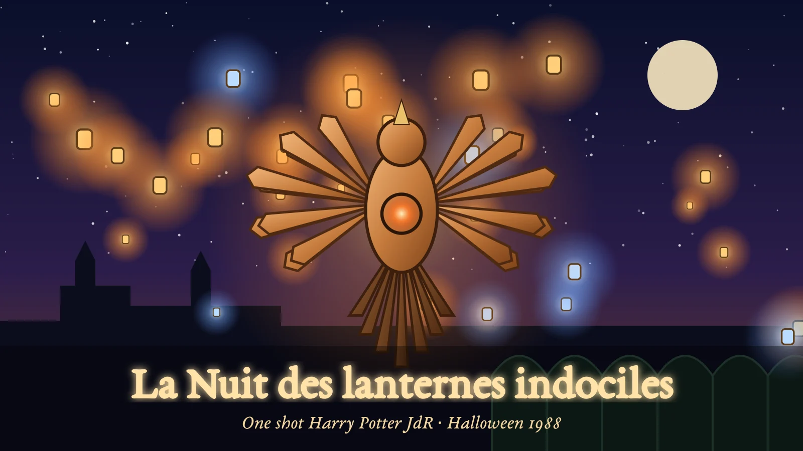

# La Nuit des lanternes indociles



One shot **Harry Potter JdR** (Geek-It, manuel v1.12) pour le système Foundry [`hogwarts-system`](https://github.com/nerokiryu/HP-System). Poudlard, 31 octobre 1988 : à la fête des lanternes enchantées, le phénix de cuivre qui doit tout allumer reçoit plus d’énergie qu’il n’en libère. Cinq élèves de troisième année, quatre à cinq heures de jeu : enquête, magie pratique, rivalité scolaire et sauvetage.

## Prérequis

| | Version |
|---|---|
| Foundry VTT | 14 (vérifié en 14.369) |
| Système hogwarts-system | 1.2.1 |

## Installation

Dans Foundry : **Modules complémentaires → Installer un module**, puis collez l’URL du manifeste :

```
https://github.com/PrevotYann/la-nuit-des-lanternes-indociles/releases/latest/download/module.json
```

## Lancer le scénario

1. Activez le module dans un monde **hogwarts-system**.
2. À la première connexion, le MJ se voit proposer l’import (sinon : macro ou réglage du module *Importer l’aventure*, ou compendium **La Nuit des lanternes indociles — aventure** → *Importer*).
3. Ouvrez le journal **La Nuit des lanternes indociles — Guide du MJ**, page *Démarrage rapide*.

L’import ne modifie rien d’autre : les scènes restent inactives, les prétirés sont importés sans propriétaire et les journaux ne sont pas partagés. Un réimport propose soit de **réutiliser** l’existant (seuls les documents manquants sont recréés), soit de créer une **nouvelle copie** ; aucune suppression n’est faite.

## Contenu

- **Guide du MJ** : vérité, principes, PNJ, quatre scènes, tableau des indices, finale, dénouements, adversaires, prétirés, plans, contrôle de cohérence. Les textes à lire sont mis en évidence ; liens directs vers les scènes, acteurs, aides et actions du panneau.
- **Cinq prétirés** (Alix, Noor, Malo, Iris, Tom) : caractéristiques adultes stockées (le système applique le malus d’âge), compétences sur les presets du système avec spécialisations, matières scolaires de troisième année, baguette, matériel. Les **sorts** et la dose d’**Essence de Murlap** sont copiés à l’import depuis les compendiums du système, origine conservée.
- **Cinq fiches joueurs** séparées, sans secret de MJ, et **six aides** A01 à A06 (dont le schéma d’arrêt et le croquis du carnet).
- **PNJ** : Agathe Wren, Basile Rook, Maëlle Pritchard ; **automate** : le cerf de bois zélé.
- **Cinq scènes** (cour, atelier, serre basse, coursive, chambre du phénix) avec tokens, notes vers le guide et lumières ; la cour a un état *fête* et un état *incident*, la chambre un état *éteint*.
- **Panneau du défi** (macro *Lanternes · Panneau du défi*) : jauge de surchauffe 0–8 et étapes de l’enquête, accessoires (bénéfice donné une seule fois), trois opérations du finale avec leur ordre, fin de cycle, proposition d’arrêt de sécurité à 8, issue à annoncer, conclusions partagées, aides à montrer, états des cartes, points de maison (avec confirmation). Les joueurs disposent d’une **vue de suivi** sans secret.
- **Ambiances** : playlist de quatre boucles originales (cour, atelier, serre, phénix), volume et arrêt depuis l’onglet Playlists.

Les cartes, portraits, tokens, aides illustrées et sons sont des créations originales générées par programme (`tools/art.mjs`, `tools/audio.mjs`). L’intrigue, les PNJ, la plante de décor, le phénix mécanique, les automates et le défi sont des créations originales de ce scénario.

## Développement

Le build tourne dans Docker (Node 24, ffmpeg, polices) et lit le système installé pour vérifier les références de compendium :

```bash
docker build -t lanternes-build tools/docker
sh tools/docker/run.sh "npm install && npm run all && npm run release"
```

- `npm run art` : images (SVG → WebP) ; `npm run audio` : ambiances (Ogg Vorbis).
- `npm run build` : reconstruit `packs/aventure` depuis `source/La_Nuit_des_Lanternes_Indociles.md`, `tools/data.mjs` et `tools/layout.mjs`, contrôle les 400 points de chaque prétiré, les plafonds, les liens internes et les UUID du système.
- `npm run validate` : présence de chaque fichier référencé, cohérence des versions.
- `npm run release` : `dist/la-nuit-des-lanternes-indociles.zip` et `dist/module.json`.

`HP_SYSTEM_HOST` (hôte) désigne le dossier du système hogwarts-system installé, monté en lecture seule dans le conteneur.

## Licence

Code sous licence MIT. Scénario de fan non officiel et sans affiliation : l’univers Harry Potter appartient à J. K. Rowling et à ses ayants droit ; Harry Potter JdR est un jeu amateur de Geek-It.
